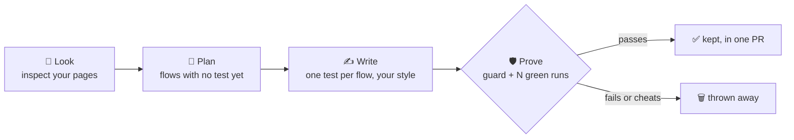

<p align="center">
  
</p>

<h1 align="center">KeepGreen</h1>

<p align="center"><b>🤖 GaaS for end-to-end testing: your own AI QA engineer, live in 60 seconds.</b><br>
<b>The AI test agent that writes, fixes and keeps your end-to-end tests green.</b><br>
It finds the user flows nobody tests, writes a test for each, and fixes tests when your UI changes.<br>
Every test it keeps <b>proved itself</b>: real assertions, green run after run.</p>

<p align="center">

[](https://www.npmjs.com/package/keepgreen) [](https://www.npmjs.com/package/keepgreen) [](https://github.com/xsignon-secure/keepgreen/actions/workflows/ci.yml) [](https://www.npmjs.com/package/keepgreen#provenance) [](LICENSE) [](#-free-forever) [](#-gaas-ai-testing-as-a-service-without-the-service)

</p>

<p align="center">⭐ <b>If KeepGreen saves you a test-writing afternoon, <a href="https://github.com/xsignon-secure/keepgreen">a star</a> helps other teams find it.</b></p>

<p align="center">
  <a href="#-start-in-60-seconds">Start in 60 seconds</a> ·
  <a href="#-gaas-ai-testing-as-a-service-without-the-service">GaaS</a> ·
  <a href="#-github-actions">GitHub Actions</a> ·
  <a href="#-how-explore-works">How it works</a> ·
  <a href="#%EF%B8%8F-settings">Settings</a> ·
  <a href="#-security">Security</a> ·
  <a href="CHANGELOG.md">Changelog</a>
</p>

KeepGreen runs **on your own CI runner or laptop, with your own AI key**: Anthropic, OpenAI,
OpenRouter, or any OpenAI-compatible endpoint including local models. There is no KeepGreen
server, no account and no telemetry. You pay only your AI provider, and one spend cap covers
every run.

## 🚀 GaaS: AI testing as a service, without the service

**GaaS** means Generative and Agentic AI as a Service. KeepGreen gives you the "as a service"
part, an AI agent that does a QA engineer's job on every red build and every week, **without** the parts you
don't want: no vendor, no account, no seat price, no platform holding your code.

| | Typical hosted AI testing tools | **KeepGreen GaaS** |
| --- | --- | --- |
| Setup | sign-up, SDK or app install, dashboard | **`npx keepgreen init`** |
| Who runs the agent | their cloud | **your GitHub Actions runner** |
| Your code and app | sent to their cloud | **stays in your CI** (only your AI provider sees the prompts) |
| Price | per seat or per test run | **free (MIT)**, you pay only your AI key |
| A real run on our demo shop | | **2 new tests, about $0.04** |
| What lands in your repo | depends on the tool | **only tests that passed every run and the anti-cheat guard** |

One command turns your repository into a self-driving test team:

- 🔍 **It explores.** It opens your app, finds the important flows nobody tested, and writes the tests.
- 🩹 **It heals.** When a UI change breaks a test, it opens a fix PR with proof. Real app bugs are reported, not hidden.
- 🔐 **It signs in.** Flows behind a login are covered too. Passwords stay in your CI secrets.
- 🛡️ **It can't cheat.** Tests that can't fail, skips, fake network answers and deleted assertions are thrown away.
- 💸 **It can't overspend.** One `max-usd` cap per run, on your own key.

## ⚡ Start in 60 seconds

In your project folder, with your AI key in the shell (Anthropic, OpenAI or OpenRouter):

```bash
export ANTHROPIC_API_KEY=sk-ant-...     # or OPENAI_API_KEY, or OPENROUTER_API_KEY
npx keepgreen init                      # 1. sets everything up
git add . && git commit -m "Add KeepGreen" && git push   # 2. ship it
```

**3.** Open *Actions > KeepGreen explore > Run workflow*. A few minutes later you get **one PR
with new, proven tests**.

What `init` does for you:

- finds where your app runs (`playwright.config` webServer or baseURL, or your `dev`/`start`
  script and its port) and how CI installs it (npm, pnpm, yarn or pip),
- writes `.keepgreen.yml`, the explore workflow and AutoHeal's heal workflow, set to your AI
  provider,
- with the [GitHub CLI](https://cli.github.com) signed in, it asks to add your key as a repository
  secret and to let Actions open PRs. The key goes straight to GitHub and is never printed.
  Without `gh`, it prints the two links to click.

Want to see it first? `npx keepgreen explore --dry-run` plans the flows on your machine and
writes nothing.

## ❌ Without it / ✅ With it

**Without it**, the checkout page ships with no end-to-end test because nobody had time to write
one. When a test does exist, a renamed button turns CI red and someone spends an hour patching
selectors, or an AI "fixes" it by deleting the assertion that mattered.

**With it**, KeepGreen opens your app, sees which important flows have no test, writes one for
each and opens **one pull request** with only the tests that passed every run. When the UI
changes, it fixes the broken test and proves the fix. When the app is really broken, it tells you
it's an app bug instead of "fixing" the test.

> **Real run, real cost.** On our [demo shop](https://github.com/xsignon-secure/autoheal-demo),
> one KeepGreen run inspected 3 pages, planned 2 untested flows and opened
> [a PR with 2 new tests](https://github.com/xsignon-secure/autoheal-demo/pull/9). Each passed
> 3 runs in a row and the anti-cheat guard. Total AI spend: **about $0.04**.

## ✨ What you get

| Recipe | What it does | Command |
| --- | --- | --- |
| 🔍 **Explore** | Looks at your app, picks the most important user flows that have **no test yet**, and writes a test for each. A test is kept only if it makes real assertions and passes every run (5 by default). | `npx keepgreen explore` |
| 🎯 **Explore one flow** | Skip the planning: name the flow, get the test. | `npx keepgreen explore --flow "..."` |
| 🔐 **Behind a login** | Signs in once (2FA too), plans and writes tests as that user. Secrets stay in your environment. | `login-steps:` in `.keepgreen.yml` |
| 🩹 **Heal** | Runs your tests, finds what broke, fixes it and proves the fix. App bugs are reported, not "fixed". | `npx keepgreen heal` (local) · AutoHeal workflow (CI) |

- **Anti-cheat guard.** Tests without real assertions, or with skips, faked network answers,
  fixed waits, forced clicks or retries, are thrown away.
- **Proven, not hoped.** A new test must pass `runs` times in a row before it's kept.
- **Your style.** Tests follow your project's imports, fixtures and locator style.
- **One PR, only new files.** In CI, the publish step accepts nothing but new test files.
- **One spend cap.** `max-usd` covers planning plus every flow. OpenRouter prices are looked up
  for you.
- **Works with** Playwright Test and pytest-playwright. Healing also covers Cypress and
  WebdriverIO.

KeepGreen joins two XSignOn projects into one agent:
[playwright-e2e-mcp](https://github.com/xsignon-secure/E2E) is the toolbox (opens pages, finds
stable locators, runs tests, reads failures) and [AutoHeal](https://github.com/xsignon-secure/AutoHeal-AI)
is the guarded fixer and test writer.

## 💻 On your machine

```bash
npm install -D keepgreen              # or use npx keepgreen ... without installing
export ANTHROPIC_API_KEY=sk-ant-...   # your own key
npx keepgreen explore                 # uses the app found by init (.keepgreen.yml)
```

Explore prints a table of the flows it tried and which tests it kept. New files are named after
the flow, such as `tests/keepgreen-adds-coffee-mug-cart-count-shows.spec.ts`. Review them with
`git diff` and commit the ones you like.

```bash
# Plan only: show the flows it would test, write nothing
npx keepgreen explore --url http://localhost:3000 --dry-run

# Test the flows you name (repeat --flow for more)
npx keepgreen explore --url http://localhost:3000 \
  --flow "A shopper adds the coffee mug to the cart and the cart count shows 1"

# Let KeepGreen start your app
npx keepgreen explore --start-command "npm run dev" --start-url http://localhost:3000

# A deployed staging or preview app works too (use a test environment, not production)
npx keepgreen explore --url https://staging.example.com

# Fix broken tests; changes stay in your working tree for review
npx keepgreen heal
```

## 🤖 GitHub Actions

`npx keepgreen init` writes two workflows:

- **`.github/workflows/keepgreen-explore.yml`** runs from *Actions > KeepGreen explore > Run
  workflow*, or weekly if you uncomment the schedule. It opens **one PR** with the new tests that
  passed. The explore job runs the AI-written tests with a read-only token. The publish job
  accepts the result only if it just adds test files, then opens the PR. A scheduled run skips
  itself while an earlier KeepGreen PR is still open.
- **`.github/workflows/autoheal.yml`** is written by AutoHeal's own `init`. It runs after your
  test workflow fails and opens a fix PR.

`init` sets both to your package manager and AI provider. With `gh` it also adds the key secret
and the PR permission. By hand, that is:

1. Add your key as a repository secret: `ANTHROPIC_API_KEY`, `OPENAI_API_KEY` (plus a repository
   variable `AUTOHEAL_MODEL`) or `OPENROUTER_API_KEY`.
2. Go to *Settings > Actions > General > Workflow permissions* and tick "Allow GitHub Actions to
   create and approve pull requests".
3. If your tests need services (a database, env vars), add them to the explore job like in your
   test workflow.
4. Optional: add a fine-grained token (this repo only; Contents and Pull requests: read and
   write) as the secret `KEEPGREEN_PR_TOKEN`. GitHub runs no CI on PRs opened with the built-in
   token; with this one, your checks run on KeepGreen's PRs.

Or use the action directly:

```yaml
- uses: xsignon-secure/keepgreen@v0.4.0
  with:
    url: http://localhost:3000
    anthropic-api-key: ${{ secrets.ANTHROPIC_API_KEY }}
    # flows: |                       # optional: skip planning
    #   A visitor logs in and sees the dashboard
# leaves keepgreen-out/ (report.md, summary.json, new-tests.patch); output `written` = tests kept
```

## 🔍 How explore works



1. **Look.** It opens your app's start page and every path in `pages:` with playwright-e2e-mcp's
   `inspect-page`, which lists the interactive elements and their locators.
2. **Plan.** It reads the titles of your existing tests and asks your AI for the most important
   user flows that have no test yet. Flows that pay money, send email or delete data are skipped.
   With `--flow`, this step is skipped.
3. **Write.** For each flow, AutoHeal's `cover` explores the pages, checks every locator, and
   writes one test in your project's own style.
4. **Prove.** The new-test guard rejects tests that cannot fail, or that use skips, faked network
   answers, fixed waits, forced clicks or retries. The test must then pass every run in a row.
   Anything less is thrown away.

One `max-usd` cap covers the whole run. Each flow gets an even share of what is left, so money one
flow saves goes to the next.

## ⚙️ Settings

`.keepgreen.yml` at the repo root. Command-line flags override it.

```yaml
url: http://localhost:3000        # the running app (local, staging or preview), or:
# start-command: npm run dev
# start-url: http://localhost:3000
pages:                            # extra pages to look at when choosing flows
  - /login
  - /pricing
max-flows: 3                      # new tests per explore run (1-10)
max-usd: 3                        # AI spend cap for one explore run
runs: 5                           # passing runs in a row a new test needs (2-20)
framework: auto                   # auto | playwright | pytest | cypress | webdriverio
```

AI settings use AutoHeal's variables:

| Variable | Meaning |
| --- | --- |
| `ANTHROPIC_API_KEY` | Use Anthropic (default model `claude-opus-5-5`) |
| `OPENAI_API_KEY` + `AUTOHEAL_MODEL` | Use OpenAI |
| `AUTOHEAL_BASE_URL` + `AUTOHEAL_MODEL` (+ `AUTOHEAL_API_KEY`) | Any OpenAI-compatible endpoint: OpenRouter, or Ollama at `http://localhost:11434/v1` |
| `AUTOHEAL_EFFORT` | Anthropic effort: `low` … `max` (default `medium`) |
| `AUTOHEAL_PRICE_IN` / `AUTOHEAL_PRICE_OUT` | USD per 1M tokens, for models without a known price |

### OpenRouter (or any OpenAI-compatible endpoint)

```bash
export AUTOHEAL_BASE_URL=https://openrouter.ai/api/v1
export AUTOHEAL_API_KEY=sk-or-...            # your OpenRouter key; give it a credit limit
export AUTOHEAL_MODEL=anthropic/claude-sonnet-5.5
npx keepgreen explore --url http://localhost:3000
```

KeepGreen looks up the model's price in OpenRouter's public model list, so `max-usd` is enforced.
For other endpoints, set `AUTOHEAL_PRICE_IN` and `AUTOHEAL_PRICE_OUT`.

In the Action: `base-url: https://openrouter.ai/api/v1`, `api-key: ${{ secrets.OPENROUTER_API_KEY }}`
and `model: ...`.

### Flows behind a login

Most important flows need a signed-in user. Add the login steps to `.keepgreen.yml`:

```yaml
login-url: /login
login-steps:
  - fill getByLabel('Email') = {{env:E2E_USER}}
  - fill getByLabel('Password') = {{env:E2E_PASSWORD}}
  - click getByRole('button', { name: 'Sign in' })
login-check: getByRole('button', { name: 'Sign out' })   # only a signed-in user sees it
# login-totp-env: E2E_TOTP_SECRET                         # if a step types {{totp}} (2FA)
# session: playwright/.auth/user.json                     # where the session is saved
```

KeepGreen signs in once through playwright-e2e-mcp's `save-login`, looks at your pages as that
user, plans flows that keep the session valid (no logging out or account changes), and every new
test loads the same session with `test.use({ storageState })` (pytest: `browser_context_args`).

- **Secrets stay out of everything.** `{{env:E2E_PASSWORD}}` is filled in by the browser engine
  at the moment it is typed; the AI, the logs and the test files never see it. Only variables
  named `E2E_*`, `TEST_*`, `PW_*`, `PLAYWRIGHT_*` or `LOGIN_*` can be used, and a step that types
  a password as plain text is refused.
- **A failed login stops the run** before any AI spend.
- **Already make a session** in a [Playwright setup project](https://playwright.dev/docs/auth)?
  Set just `session: playwright/.auth/user.json` and run the setup project first.
- **Your CI must create the same session** before the new tests run, usually with that setup
  project. Keep the session file in `.gitignore`; KeepGreen never commits it.
- In the Action, pass the secrets as `env:` on the KeepGreen step (`E2E_USER: ${{ secrets.E2E_USER }}`).
- Steps: `goto`, `fill <locator> = <value>`, `press <locator> = <key>`, `select <locator> = <option>`,
  `click`, `dblclick`, `hover`, `check`, `uncheck`, `wait <locator>` or `wait <ms>`. Quote a
  step that has ` #` in it (a CSS id), or YAML reads the rest as a comment.

The same works with flags: `--login-url`, `--login-step` (repeat it), `--login-check`,
`--login-totp-env`, `--session`.

### Playwright `webServer`

If your `playwright.config` starts the app with `webServer`, and KeepGreen starts it too
(`start-command`), let Playwright reuse it during a KeepGreen run:

```ts
webServer: { command: 'npm run start', url: 'http://127.0.0.1:3000/', reuseExistingServer: !process.env.CI || !!process.env.KEEPGREEN },
```

## 📖 All commands

```
keepgreen init [--provider anthropic|openai|openrouter] [--url <app> | --start-command <cmd>
               --start-url <url>] [--github | --no-github] [--force] [--dry-run]
keepgreen doctor
keepgreen explore [--url <app>] [--start-command <cmd> --start-url <url>] [--pages /a,/b]
                  [--flow "<sentence>" ...] [--max-flows 3] [--max-usd 3] [--runs 5]
                  [--dry-run] [--out <dir>]
keepgreen heal [AutoHeal fix options]
keepgreen autoheal <command> [...]      # any AutoHeal command: learn, metrics, dashboard, ...
keepgreen check-patch <file>            # CI publish step
keepgreen --version
```

## 🏠 Self-host bundle (optional)

KeepGreen needs no server. If you want **test history across all CI runs** (flaky ranking, the
commit where a test went bad) and **AutoHeal's dashboard** (fixes, blocked cheats, AI spend),
[`selfhost/`](selfhost/) starts both servers with one command:

```bash
cd selfhost && sh make-env.sh your-org/your-repo && docker compose up -d --build
```

## 🔒 Security

See [SECURITY.md](SECURITY.md). In short: your key goes only to your AI provider, AI-written tests
never run with a write token or your AI key, the publish step only accepts new test files, and
every change arrives as a PR for a person to review. Forks never get your secrets. Login
passwords are typed by the browser engine from your environment and never reach the AI.

## 💚 Free forever

MIT licensed. Free for any use, with no paid tier, no account and no telemetry. Releases are
published from CI with [npm provenance](https://www.npmjs.com/package/keepgreen#provenance).

Issues and pull requests are welcome. If KeepGreen helps you, ⭐ the repo so others can find it.
